# KSYN FitConnect Enterprise Platform - Architectural Diagrams

## 1. User Requirement Diagram (URD)

```mermaid
flowchart TD
    %% Global Styling Classes
    classDef rootNode fill:#0f172a,stroke:#38bdf8,stroke-width:2px,color:#f8fafc;
    classDef categoryNode fill:#1e293b,stroke:#94a3b8,stroke-width:2px,color:#f1f5f9;
    classDef roleReqNode fill:#1e1b4b,stroke:#818cf8,stroke-width:1.5px,color:#e0e7ff;
    classDef nfrReqNode fill:#064e3b,stroke:#34d399,stroke-width:1.5px,color:#ecfdf5;

    %% Root System Requirement
    REQ_ROOT["<b>REQ-SYS-00: KSYN FitConnect Enterprise Platform</b><br/>Multi-Tenant Franchise Architecture with RBAC & Tenant Data Isolation"]:::rootNode

    %% Category Nodes
    CAT_FUNC["<b>Functional Requirements by Role</b><br/>Role Specific Duties & Least Privilege Matrix"]:::categoryNode
    CAT_NFR["<b>Non-Functional Security & Compliance Requirements</b><br/>ISO/IEC 25010, ISO/IEC 27001, RA 10173 & PCI Standards"]:::categoryNode

    REQ_ROOT --> CAT_FUNC
    REQ_ROOT --> CAT_NFR

    %% Subgraph: Functional Requirements by Persona
    subgraph S_FUNCTIONAL ["Functional Requirements Breakdown"]
        direction TB

        %% 1. Gym Member
        subgraph G_MEMBER ["Role 1: Gym Member"]
            REQ_F_MEM_01["<b>REQ-F-MEM-01: Self-Registration & Auth</b><br/>Account setup, credential management, profile view"]:::roleReqNode
            REQ_F_MEM_02["<b>REQ-F-MEM-02: Digital PAR-Q Waiver</b><br/>Pre-activity readiness questionnaire with SHA-256 legal seal"]:::roleReqNode
            REQ_F_MEM_03["<b>REQ-F-MEM-03: Multi-Rail Online Payment</b><br/>Xendit 3DS card tokenization, e-wallets (GCash/Maya), QR Ph"]:::roleReqNode
            REQ_F_MEM_04["<b>REQ-F-MEM-04: Dynamic Optical Pass</b><br/>60s rotating HMAC-SHA256 digital pass with single-use nonce"]:::roleReqNode
            REQ_F_MEM_05["<b>REQ-F-MEM-05: Group Class Booking</b><br/>Session reservation, waitlist queue, booking cancellation"]:::roleReqNode
            REQ_F_MEM_06["<b>REQ-F-MEM-06: Workout & Attendance History</b><br/>Check-in log history, personal trainer session logs, RPE records"]:::roleReqNode
        end

        %% 2. Coach / Trainer
        subgraph G_COACH ["Role 2: Coach / Trainer"]
            REQ_F_COA_01["<b>REQ-F-COA-01: Class Roster Assignment</b><br/>Group class schedule view, studio roster synchronization"]:::roleReqNode
            REQ_F_COA_02["<b>REQ-F-COA-02: Attendance Roll Call</b><br/>In-studio check-in verification and walk-in athlete admission"]:::roleReqNode
            REQ_F_COA_03["<b>REQ-F-COA-03: 1-on-1 PT Tracking</b><br/>Client workout logging, exercise sets, RPE intensity rating"]:::roleReqNode
            REQ_F_COA_04["<b>REQ-F-COA-04: PT Package Cap Enforcement</b><br/>Session decrementing, package renewal gate enforcement"]:::roleReqNode
            REQ_F_COA_05["<b>REQ-F-COA-05: Commission Telemetry</b><br/>Contract split calculation (60% tier), monthly payout slip"]:::roleReqNode
        end

        %% 3. Front Desk / Cashier
        subgraph G_FRONTDESK ["Role 3: Front Desk / Cashier"]
            REQ_F_FDK_01["<b>REQ-F-FDK-01: Shift Drawer Opening</b><br/>Workstation opening float capture (₱2,000 baseline)"]:::roleReqNode
            REQ_F_FDK_02["<b>REQ-F-FDK-02: Member Directory Lookup</b><br/>Subscription validation, multi-branch roaming quota check"]:::roleReqNode
            REQ_F_FDK_03["<b>REQ-F-FDK-03: Over-The-Counter Sales</b><br/>Walk-in day pass checkout, merchandise POS ledger logging"]:::roleReqNode
            REQ_F_FDK_04["<b>REQ-F-FDK-04: Physical RFID Pairing</b><br/>13.56MHz RC522 keycard UID assignment to active member"]:::roleReqNode
            REQ_F_FDK_05["<b>REQ-F-FDK-05: Blind Cash Shift Handover</b><br/>Cash drop denomination count, X-Reading breakdown generation"]:::roleReqNode
            REQ_F_FDK_06["<b>REQ-F-FDK-06: Reception Admission Feed</b><br/>Real-time gate scan alerts, guest roaming fee collection (₱350)"]:::roleReqNode
        end

        %% 4. Branch Admin / Manager
        subgraph G_BRANCHADMIN ["Role 4: Branch Admin / Branch Manager"]
            REQ_F_BAD_01["<b>REQ-F-BAD-01: Staff Rostering & Timeclock</b><br/>Employee weekly shift assignments, timeclock punch audit"]:::roleReqNode
            REQ_F_BAD_02["<b>REQ-F-BAD-02: Equipment Work Orders</b><br/>Equipment registry, maintenance work orders, telemetry tracking"]:::roleReqNode
            REQ_F_BAD_03["<b>REQ-F-BAD-03: Inventory Restock Requests</b><br/>Reorder threshold alerts, procurement submissions to corporate"]:::roleReqNode
            REQ_F_BAD_04["<b>REQ-F-BAD-04: Daily Store Z-Reading</b><br/>Consolidated multi-shift end-of-day register financial audit"]:::roleReqNode
            REQ_F_BAD_05["<b>REQ-F-BAD-05: Shift Variance & Incident Review</b><br/>Supervisor PIN authorization, disciplinary incident tracking"]:::roleReqNode
            REQ_F_BAD_06["<b>REQ-F-BAD-06: 1-Day Pass Raffle Awarding</b><br/>Monthly promotional raffle applicant review, winner issuance"]:::roleReqNode
        end

        %% 5. Branch Owner / Franchisee
        subgraph G_BRANCHOWNER ["Role 5: Branch Owner / Franchisee"]
            REQ_F_BOW_01["<b>REQ-F-BOW-01: Branch Financial Performance</b><br/>Single-branch net profitability, revenue stream analytics"]:::roleReqNode
            REQ_F_BOW_02["<b>REQ-F-BOW-02: Sales vs Expense Audit</b><br/>Gross collections audit against verified petty cash vouchers"]:::roleReqNode
            REQ_F_BOW_03["<b>REQ-F-BOW-03: 7.5% Royalty Remittance Review</b><br/>Automated corporate franchise royalty calculation statement"]:::roleReqNode
            REQ_F_BOW_04["<b>REQ-F-BOW-04: Payroll & Commission Oversight</b><br/>Staff salaries, trainer commissions, net payout verification"]:::roleReqNode
        end

        %% 6. Super Admin / Corporate HQ
        subgraph G_SUPERADMIN ["Role 6: Super Admin / Corporate HQ"]
            REQ_F_SAD_01["<b>REQ-F-SAD-01: Multi-Tenant Branch Config</b><br/>Global branch provisioning (Makati, Katipunan, Alabang, etc.)"]:::roleReqNode
            REQ_F_SAD_02["<b>REQ-F-SAD-02: Subscription Tier Governance</b><br/>Enterprise pricing schedules, access fees, global rate-cards"]:::roleReqNode
            REQ_F_SAD_03["<b>REQ-F-SAD-03: System-Wide Royalty Ledger</b><br/>Consolidated 7.5% corporate remittance accrual monitoring"]:::roleReqNode
            REQ_F_SAD_04["<b>REQ-F-SAD-04: Franchise Pipeline Review</b><br/>Prospective franchisee inquiry vetting, due diligence pipeline"]:::roleReqNode
            REQ_F_SAD_05["<b>REQ-F-SAD-05: Cryptographic Audit Verification</b><br/>SHA-256 append-only tamper-evident hash chain inspection"]:::roleReqNode
            REQ_F_SAD_06["<b>REQ-F-SAD-06: Network Emergency Broadcast</b><br/>Global critical banner and announcement distribution"]:::roleReqNode
        end
    end

    %% Subgraph: Non-Functional Security & Compliance Requirements
    subgraph S_NONFUNCTIONAL ["Non-Functional Security & Compliance Matrix"]
        direction TB
        REQ_NF_PCI["<b>REQ-NF-PCI: Zero-PAN PCI Compliance</b><br/>No primary account numbers stored locally; tokenized Xendit 3DS rails"]:::nfrReqNode
        REQ_NF_HMAC["<b>REQ-NF-HMAC: Replay-Proof Pass Rotation</b><br/>HMAC-SHA256 signed payloads, 60s window, single-use nonce eviction"]:::nfrReqNode
        REQ_NF_APB["<b>REQ-NF-APB: 15-Minute Anti-Passback Control</b><br/>Re-entry lockout preventing card sharing; supervisor PIN override"]:::nfrReqNode
        REQ_NF_POS["<b>REQ-NF-POS: Strict Shift Cash Isolation</b><br/>Cashier blind drop, immutable register sessions, expected vs actual variance"]:::nfrReqNode
        REQ_NF_RLS["<b>REQ-NF-RLS: Multi-Tenant Data Isolation</b><br/>PostgreSQL Row-Level Security on branch_id; blocks IDOR/BOLA cross-tenant leaks"]:::nfrReqNode
        REQ_NF_AUD["<b>REQ-NF-AUD: ISO/IEC 27001 Cryptographic Audit</b><br/>Immutable audit trail linked with previous record hash chains"]:::nfrReqNode
        REQ_NF_DPA["<b>REQ-NF-DPA: RA 10173 Philippine Data Privacy</b><br/>Elimination of paper logbooks; encrypted PII, masked operational telemetry"]:::nfrReqNode
    end

    %% Category Hierarchy Links
    CAT_FUNC --> G_MEMBER
    CAT_FUNC --> G_COACH
    CAT_FUNC --> G_FRONTDESK
    CAT_FUNC --> G_BRANCHADMIN
    CAT_FUNC --> G_BRANCHOWNER
    CAT_FUNC --> G_SUPERADMIN

    CAT_NFR --> REQ_NF_PCI
    CAT_NFR --> REQ_NF_HMAC
    CAT_NFR --> REQ_NF_APB
    CAT_NFR --> REQ_NF_POS
    CAT_NFR --> REQ_NF_RLS
    CAT_NFR --> REQ_NF_AUD
    CAT_NFR --> REQ_NF_DPA

    %% Traces and Satisfies Relations
    REQ_F_MEM_03 -.->|"traces"| REQ_NF_PCI
    REQ_F_MEM_04 -.->|"satisfies"| REQ_NF_HMAC
    REQ_F_MEM_04 -.->|"satisfies"| REQ_NF_APB
    REQ_F_MEM_02 -.->|"traces"| REQ_NF_DPA
    REQ_F_FDK_01 -.->|"satisfies"| REQ_NF_POS
    REQ_F_FDK_05 -.->|"satisfies"| REQ_NF_POS
    REQ_F_BAD_04 -.->|"satisfies"| REQ_NF_POS
    REQ_F_BAD_01 -.->|"satisfies"| REQ_NF_RLS
    REQ_F_COA_01 -.->|"satisfies"| REQ_NF_RLS
    REQ_F_BOW_01 -.->|"satisfies"| REQ_NF_RLS
    REQ_F_SAD_01 -.->|"satisfies"| REQ_NF_RLS
    REQ_F_SAD_05 -.->|"satisfies"| REQ_NF_AUD
    REQ_F_FDK_06 -.->|"satisfies"| REQ_NF_DPA
```

---

## 2. UML Use Case Diagram

```mermaid
flowchart LR
    %% Actor Styling
    classDef humanActor fill:#0284c7,stroke:#0369a1,stroke-width:2px,color:#ffffff;
    classDef systemActor fill:#475569,stroke:#334155,stroke-width:2px,color:#ffffff;
    classDef ucStandard fill:#ffffff,stroke:#2563eb,stroke-width:1.5px,color:#1e293b;
    classDef ucIncluded fill:#eff6ff,stroke:#1d4ed8,stroke-width:1.5px,color:#1e3a8a;

    %% Human Actors
    subgraph S_HUMAN_ACTORS ["Internal Human Roles"]
        ACT_MEM["fa:fa-user Member<br/>(Gym Member)"]:::humanActor
        ACT_COA["fa:fa-dumbbell Coach<br/>(Personal Trainer)"]:::humanActor
        ACT_FDK["fa:fa-cash-register Front Desk<br/>(Cashier / Reception)"]:::humanActor
        ACT_BAD["fa:fa-user-tie Branch Admin<br/>(Branch Manager)"]:::humanActor
        ACT_BOW["fa:fa-building Branch Owner<br/>(Franchisee)"]:::humanActor
        ACT_SAD["fa:fa-crown Super Admin<br/>(Corporate HQ)"]:::humanActor
    end

    %% External System / Hardware Actors
    subgraph S_EXTERNAL_ACTORS ["External Actors"]
        ACT_XEN["fa:fa-credit-card «External System»<br/>Xendit Payment API"]:::systemActor
        ACT_ESP["fa:fa-microchip «Hardware Node»<br/>ESP32 Turnstile Node"]:::systemActor
    end

    %% Boundary 1: Member Self-Service & Turnstile Access
    subgraph SB_MEMBER ["Member Self-Service & Turnstile Access"]
        UC_M_REG["Self-Register Member Profile"]:::ucStandard
        UC_M_PARQ["Sign Digital PAR-Q Waiver"]:::ucIncluded
        UC_M_PLAN["Settle Membership Plan"]:::ucStandard
        UC_M_3DS["Verify 3DS / OTP / Webhook"]:::ucIncluded
        UC_M_UPG["Upgrade Tier Entitlement"]:::ucIncluded
        UC_M_PASS["Generate 60s Dynamic QR Pass"]:::ucStandard
        UC_M_TAP["Present Dynamic QR / RFID Credential"]:::ucStandard
        UC_M_VERIFY["Validate HMAC & Nonce Replay"]:::ucIncluded
        UC_M_APB["Check 15-Minute Anti-Passback"]:::ucIncluded
        UC_M_OVR["Authorize Supervisor APB Override"]:::ucIncluded
        UC_M_RELAY["Pulse Solenoid Relay (3000ms)"]:::ucIncluded
        UC_M_HIST["View Workout & Attendance Log"]:::ucStandard
    end

    %% Boundary 2: Class & Training Scheduling
    subgraph SB_CLASS ["Class & Training Scheduling"]
        UC_C_BOOK["Book Group Fitness Class"]:::ucStandard
        UC_C_SYNC["Auto-Bind Turnstile to Class Roster"]:::ucIncluded
        UC_C_ROLL["Execute Floor Roll Call"]:::ucStandard
        UC_C_LOG["Log 1-on-1 PT Session & RPE"]:::ucStandard
        UC_C_CAP["Enforce Package Session Limit"]:::ucIncluded
        UC_C_PLAN["Build Personalized Workout Routine"]:::ucStandard
        UC_C_PAY["View Commission Slip & Payroll Split"]:::ucStandard
    end

    %% Boundary 3: POS Cashier Operations & Shift Control
    subgraph SB_POS ["POS Cashier Operations & Shift Control"]
        UC_P_OPEN["Open Shift Drawer (Opening Float)"]:::ucStandard
        UC_P_LOOK["Lookup Member & Subscription Status"]:::ucStandard
        UC_P_OTC["Process Over-The-Counter Sale"]:::ucStandard
        UC_P_QRPH["Generate Dynamic QR Ph Code"]:::ucIncluded
        UC_P_RFID["Pair Physical RFID UID to Member"]:::ucStandard
        UC_P_CLOSE["Close Shift (Blind Cash Drop)"]:::ucStandard
        UC_P_XREAD["Generate Shift X-Reading Breakdown"]:::ucIncluded
        UC_P_VAR["Report Shift Cash Discrepancy"]:::ucIncluded
        UC_P_PIN["Validate Witness Supervisor PIN"]:::ucIncluded
    end

    %% Boundary 4: Branch Operations & Management
    subgraph SB_BRANCH ["Branch Operations & Management"]
        UC_B_SCHED["Schedule Staff Shifts & Timeclock"]:::ucStandard
        UC_B_ZREAD["Inspect Daily Store Z-Reading"]:::ucStandard
        UC_B_WO["Submit Maintenance Work Order"]:::ucStandard
        UC_B_STOCK["Submit Inventory Restock Request"]:::ucStandard
        UC_B_INC["Review Shift Variance & Incidents"]:::ucStandard
        UC_B_RAF["Award Monthly 1-Day Pass Raffle"]:::ucStandard
        UC_B_RET["Audit Churn Queue & VIP Lockers"]:::ucStandard
    end

    %% Boundary 5: Franchise Ownership & Financial Audit
    subgraph SB_OWNER ["Franchise Ownership & Financial Audit"]
        UC_F_PERF["Audit Branch Net Profit & Loss"]:::ucStandard
        UC_F_EXP["Audit Gross Sales vs Petty Expenses"]:::ucStandard
        UC_F_ROY["Review 7.5% Royalty Remittance Ledger"]:::ucStandard
        UC_F_PAY["Audit Staff & Trainer Payroll Payouts"]:::ucStandard
    end

    %% Boundary 6: Enterprise Multi-Tenant Administration
    subgraph SB_CORP ["Enterprise Multi-Tenant Administration"]
        UC_E_TENANT["Provision Branch Tenants (Postgres RLS)"]:::ucStandard
        UC_E_RATES["Govern Subscription Pricing & Promos"]:::ucStandard
        UC_E_CORP["Audit System-Wide Royalty Ledger"]:::ucStandard
        UC_E_FRAN["Process Franchise Applications Pipeline"]:::ucStandard
        UC_E_PROC["Authorize Restock Procurement Orders"]:::ucStandard
        UC_E_AUDIT["Verify Tamper-Evident Hash Audit Chain"]:::ucStandard
        UC_E_BC["Dispatch Network Emergency Broadcast"]:::ucStandard
    end

    %% Actor Relationships
    ACT_MEM --> UC_M_REG
    ACT_MEM --> UC_M_PLAN
    ACT_MEM --> UC_M_PASS
    ACT_MEM --> UC_M_TAP
    ACT_MEM --> UC_M_HIST
    ACT_MEM --> UC_C_BOOK

    ACT_COA --> UC_C_ROLL
    ACT_COA --> UC_C_LOG
    ACT_COA --> UC_C_PLAN
    ACT_COA --> UC_C_PAY

    ACT_FDK --> UC_P_OPEN
    ACT_FDK --> UC_P_LOOK
    ACT_FDK --> UC_P_OTC
    ACT_FDK --> UC_P_RFID
    ACT_FDK --> UC_P_CLOSE
    ACT_FDK --> UC_M_TAP

    ACT_BAD --> UC_B_SCHED
    ACT_BAD --> UC_B_ZREAD
    ACT_BAD --> UC_B_WO
    ACT_BAD --> UC_B_STOCK
    ACT_BAD --> UC_B_INC
    ACT_BAD --> UC_B_RAF
    ACT_BAD --> UC_B_RET

    ACT_BOW --> UC_F_PERF
    ACT_BOW --> UC_F_EXP
    ACT_BOW --> UC_F_ROY
    ACT_BOW --> UC_F_PAY
    ACT_BOW --> UC_B_ZREAD

    ACT_SAD --> UC_E_TENANT
    ACT_SAD --> UC_E_RATES
    ACT_SAD --> UC_E_CORP
    ACT_SAD --> UC_E_FRAN
    ACT_SAD --> UC_E_PROC
    ACT_SAD --> UC_E_AUDIT
    ACT_SAD --> UC_E_BC

    %% External System Links
    UC_M_PLAN <--> ACT_XEN
    UC_M_3DS <--> ACT_XEN
    UC_P_QRPH <--> ACT_XEN

    UC_M_TAP <--> ACT_ESP
    UC_M_RELAY --> ACT_ESP
    UC_P_RFID <--> ACT_ESP

    %% UML <<include>> and <<extend>> Relations
    UC_M_REG -.->|"<<include>>"| UC_M_PARQ
    UC_M_PLAN -.->|"<<include>>"| UC_M_3DS
    UC_M_UPG -.->|"<<extend>>"| UC_M_PLAN

    UC_M_TAP -.->|"<<include>>"| UC_M_VERIFY
    UC_M_TAP -.->|"<<include>>"| UC_M_APB
    UC_M_TAP -.->|"<<include>>"| UC_M_RELAY
    UC_M_OVR -.->|"<<extend>>"| UC_M_APB
    UC_M_TAP -.->|"<<extend>>"| UC_C_SYNC

    UC_C_LOG -.->|"<<include>>"| UC_C_CAP

    UC_P_OTC -.->|"<<extend>>"| UC_P_QRPH
    UC_P_CLOSE -.->|"<<include>>"| UC_P_XREAD
    UC_P_VAR -.->|"<<extend>>"| UC_P_CLOSE
    UC_P_VAR -.->|"<<include>>"| UC_P_PIN

    UC_B_ZREAD -.->|"<<include>>"| UC_P_XREAD
```

---

## 3. Data Flow Diagram Level 0 (Context Diagram)

```mermaid
flowchart TD
    %% Styling Classes
    classDef platformNode fill:#0f172a,stroke:#38bdf8,stroke-width:3px,color:#f8fafc;
    classDef humanNode fill:#1e293b,stroke:#818cf8,stroke-width:2px,color:#f1f5f9;
    classDef extNode fill:#134e4a,stroke:#2dd4bf,stroke-width:2px,color:#f0fdfa;

    %% Central Process
    PROC_CENTRAL["<b>(0) KSYN FitConnect Enterprise Platform</b><br/>Multi-Tenant Franchise Engine with PostgreSQL RLS & Hardware Bridge"]:::platformNode

    %% External Entities
    subgraph S_HUMAN_ENTITIES ["Internal Human Roles"]
        ENT_MEM["<b>Gym Member</b><br/>(Subscriber / Athlete)"]:::humanNode
        ENT_COA["<b>Coach / Trainer</b><br/>(Instructor / PT)"]:::humanNode
        ENT_FDK["<b>Front Desk / Cashier</b><br/>(Reception Workstation)"]:::humanNode
        ENT_BAD["<b>Branch Admin / Manager</b><br/>(Branch Operations)"]:::humanNode
        ENT_BOW["<b>Branch Owner / Franchisee</b><br/>(Franchise Commercial Entity)"]:::humanNode
        ENT_SAD["<b>Super Admin / Corporate HQ</b><br/>(Enterprise Leadership)"]:::humanNode
    end

    subgraph S_EXTERNAL_ENTITIES ["Hardware & Payment Gateways"]
        ENT_XEN["<b>Xendit Payment Gateway</b><br/>(Card 3DS, E-Wallets, QR Ph)"]:::extNode
        ENT_ESP["<b>ESP32 Turnstile Node</b><br/>(RC522 RFID & Solenoid Relay)"]:::extNode
    end

    %% Bidirectional Member Flows
    ENT_MEM -->|"Registration Info, PAR-Q Form, Payment Intent, Pass Request, Class Booking"| PROC_CENTRAL
    PROC_CENTRAL -->|"60s Dynamic HMAC QR Pass, Subscription Status, Booking Confirmation, Workout History"| ENT_MEM

    %% Bidirectional Coach Flows
    ENT_COA -->|"Availability Schedule, Class Roll Call Updates, PT Session Logs (RPE/Sets), Workout Plans"| PROC_CENTRAL
    PROC_CENTRAL -->|"Assigned Class Rosters, Client Roster Directory, Accrued Session Commissions, Payslip Breakdown"| ENT_COA

    %% Bidirectional Front Desk Flows
    ENT_FDK -->|"Opening Float (₱2000), Blind Cash Drop Counts, OTC Sales Tally, RFID UID Assignment, Supervisor PIN"| PROC_CENTRAL
    PROC_CENTRAL -->|"Shift Drawer State, Cashier X-Reading Breakdown, Cash Discrepancy Alert, Turnstile Admission Feed"| ENT_FDK

    %% Bidirectional Branch Admin Flows
    ENT_BAD -->|"Staff Shift Rosters, Timeclock Punches, Work Orders, Restock Orders, Incident Logs, Raffle Winner Draw"| PROC_CENTRAL
    PROC_CENTRAL -->|"Store Daily Z-Reading Report, Shift Variance Rollup, Equipment Telemetry, Churn Risk Roster"| ENT_BAD

    %% Bidirectional Branch Owner Flows
    ENT_BOW -->|"Financial Report Query, Petty Cash Voucher Approvals, Royalty Remittance Audit"| PROC_CENTRAL
    PROC_CENTRAL -->|"Single-Branch P&L Summary, Monthly Gross vs Expense Audits, 7.5% Royalty Statements"| ENT_BOW

    %% Bidirectional Super Admin Flows
    ENT_SAD -->|"Branch Provisioning, Subscription Tier Rates, Promos, Procurement Approvals, Emergency Broadcast"| PROC_CENTRAL
    PROC_CENTRAL -->|"Network-Wide Financial KPIs, Corporate Royalty Remittance Ledger, SHA-256 Audit Chain Verification"| ENT_SAD

    %% Bidirectional Xendit Gateway Flows
    PROC_CENTRAL -->|"3DS Card Tokenization Request, E-Wallet Agreement Charge, Dynamic QR Ph Creation Request"| ENT_XEN
    ENT_XEN -->|"Webhook Settlement Callback, Payment Token, Invoice Ref No, Billing Agreement Status"| PROC_CENTRAL

    %% Bidirectional ESP32 Turnstile Flows
    ENT_ESP -->|"Hardware Ping/Heartbeat, RFID UID Tap (RC522), Scanned Dynamic QR Payload String"| PROC_CENTRAL
    PROC_CENTRAL -->|"WebSocket Solenoid Relay Pulse Command (3000ms), LCD Gate Status Message, Audio/Visual Alert"| ENT_ESP
```

---

## 4. Data Flow Diagram Level 1 (Subsystem Decomposition)

```mermaid
flowchart TB
    %% Styling Classes
    classDef processNode fill:#1e293b,stroke:#38bdf8,stroke-width:2px,color:#f8fafc;
    classDef storeNode fill:#0f172a,stroke:#f59e0b,stroke-width:2px,color:#fef3c7;
    classDef entityNode fill:#042f2e,stroke:#14b8a6,stroke-width:2px,color:#ccfbf1;

    %% External Entities
    E_MEM["Gym Member"]:::entityNode
    E_COA["Coach / Trainer"]:::entityNode
    E_FDK["Front Desk / Cashier"]:::entityNode
    E_BAD["Branch Admin / Manager"]:::entityNode
    E_BOW["Branch Owner / Franchisee"]:::entityNode
    E_SAD["Super Admin / Corporate HQ"]:::entityNode
    E_XEN["Xendit Payment API"]:::entityNode
    E_ESP["ESP32 Turnstile Node"]:::entityNode

    %% Subsystems (1.0 to 7.0)
    P1["<b>(1.0) Member Identity, Waivers & Dynamic Access Issuance</b><br/>Registration, SHA-256 PAR-Q Health Seal & 60s Dynamic Pass Engine"]:::processNode
    P2["<b>(2.0) Coaching Roster & Class Schedule Management</b><br/>Class Rostering, Roll Call, 1-on-1 PT Logging & Commission Accrual"]:::processNode
    P3["<b>(3.0) POS Drawer Session Management & Cash Shift Handover</b><br/>Opening Float, Blind Cash Drop, Cashier X-Reading & Store Z-Reading"]:::processNode
    P4["<b>(4.0) Xendit Payment Gateway Settlement & Recurring Billing</b><br/>3DS Tokenization, E-Wallet Agreements, Dynamic QR Ph & Auto-Debit Cron"]:::processNode
    P5["<b>(5.0) Physical IoT Turnstile Verification & Edge Relay Control</b><br/>HMAC Validation, 15m APB Enforce, Nonce Eviction & WebSocket Pulse"]:::processNode
    P6["<b>(6.0) Branch Administration & Incident Auditing</b><br/>Staff Rostering, Equipment Work Orders, Reorders & Churn Prediction"]:::processNode
    P7["<b>(7.0) Corporate Franchise Financials & Multi-Tenant Orchestration</b><br/>RLS Isolation Context, 7.5% Corporate Royalty Ledger & Audit Chain"]:::processNode

    %% Data Stores (D1 to D6)
    D1[("<b>D1: users_and_roles</b><br/>(User credentials, supervisor PINs, RFID UIDs, branch mapping)")]:::storeNode
    D2[("<b>D2: subscriptions_and_payment_methods</b><br/>(Tiers, billing schedules, gateway tokens, auto-renew flags)")]:::storeNode
    D3[("<b>D3: pos_shifts_and_cash_drawers</b><br/>(Opening floats, blind cash drops, variance, X/Z reports)")]:::storeNode
    D4[("<b>D4: turnstile_access_logs_and_used_nonces</b><br/>(Redeemed pass nonces, APB gate history, attendance records)")]:::storeNode
    D5[("<b>D5: class_schedules_and_attendance</b><br/>(Classes, enrollments, studio roll calls, PT logs, workout routines)")]:::storeNode
    D6[("<b>D6: payment_invoices_and_franchise_sales</b><br/>(Sales receipts, invoices, petty cash expenses, 7.5% royalties)")]:::storeNode

    %% -------------------------------------------------------------
    %% (1.0) Member Identity & Access Issuance Data Flows
    %% -------------------------------------------------------------
    E_MEM -->|"Registration Info, Password, PAR-Q Form"| P1
    P1 -->|"New User Account, SHA-256 Health Seal"| D1
    P1 -->|"Query Subscription Validity"| D2
    D2 -->|"Active Status & Plan Tier"| P1
    P1 -->|"Store Generated Pass Nonce (TTL 65s)"| D4
    P1 -->|"Signed 60s Dynamic HMAC QR Pass"| E_MEM

    %% -------------------------------------------------------------
    %% (2.0) Coaching & Class Management Data Flows
    %% -------------------------------------------------------------
    E_MEM -->|"Class Booking Request, Waitlist Join"| P2
    E_COA -->|"Roll Call Update, Walk-In Entry, PT Session Log, Workout Plan"| P2
    P2 -->|"Store Booking, Update Roster, Save Workout Milestone"| D5
    D5 -->|"Class Schedules, Assigned PT Clients, Package Balances"| P2
    P2 -->|"Studio Roster Feed, Athlete Profile, Commission Telemetry"| E_COA
    P2 -->|"Log PT Session Commission Earned"| D6

    %% -------------------------------------------------------------
    %% (3.0) POS Drawer Management Data Flows
    %% -------------------------------------------------------------
    E_FDK -->|"Opening Float, Cash Tendered, Blind Cash Drop, Witness PIN"| P3
    P3 -->|"Create Shift Session, Record Cash Drops, Save Variance"| D3
    D3 -->|"Active Shift Session, Expected Drawer Cash"| P3
    P3 -->|"Query Shift Sales & Cash Collections"| D6
    D6 -->|"Aggregated Cash vs Digital Collections"| P3
    P3 -->|"X-Reading Handover Breakdown, Cash Discrepancy Alert"| E_FDK
    E_BAD -->|"Request Store End-of-Day Z-Reading Audit"| P3
    P3 -->|"Consolidated Multi-Shift Store Z-Reading Report"| E_BAD

    %% -------------------------------------------------------------
    %% (4.0) Xendit Payment Gateway Settlement Data Flows
    %% -------------------------------------------------------------
    E_MEM -->|"Plan Checkout Selection, Card Credentials, E-Wallet Auth"| P4
    E_FDK -->|"Over-The-Counter Dynamic QR Ph Sale Intent"| P4
    P4 -->|"Charge Tokenization Intent, 3DS Auth Request"| E_XEN
    E_XEN -->|"Webhook Callback (Invoice Paid, Settlement Token)"| P4
    P4 -->|"Update Subscription Validity, Next Billing Date, Status=Active"| D2
    P4 -->|"Write Financial Sale Record, Reference No, Gross Amount"| D6
    P4 -->|"Payment Receipt, QR Ph Display String"| E_FDK
    P4 -.->|"Trigger Account Provisioning & Pass Generation"| P1

    %% -------------------------------------------------------------
    %% (5.0) Turnstile Verification & Edge Relay Control Data Flows
    %% -------------------------------------------------------------
    E_ESP -->|"Hardware RFID Card Tap UID, Scanned QR Pass Base64"| P5
    E_FDK -->|"Manual Member Admission Override, Scan Terminal Input"| P5
    P5 -->|"Lookup Member by RFID UID or Token Member ID"| D1
    D1 -->|"Member Record, Assigned Branch, Supervisor Hash"| P5
    P5 -->|"Query Subscription Entitlement & Delinquency"| D2
    D2 -->|"Tier Privilege (Pro/Elite), Contract Expiry"| P5
    P5 -->|"Verify Nonce Replay & 15m APB Gate History"| D4
    D4 -->|"Prior Check-in Timestamp, Redeemed Nonces"| P5
    P5 -->|"Log Check-In Event, Nonce Eviction Timestamp"| D4
    P5 -->|"Auto-Sync Admission with Scheduled Class Roster"| D5
    P5 -->|"WebSocket Solenoid Relay Pulse Command (3000ms)"| E_ESP
    P5 -->|"Admission Granted Alert, Cross-Branch Guest Surcharge Status"| E_FDK

    %% -------------------------------------------------------------
    %% (6.0) Branch Administration & Incident Auditing Data Flows
    %% -------------------------------------------------------------
    E_BAD -->|"Staff Shift Definitions, Timeclock Punches, Work Orders, Restock Orders"| P6
    P6 -->|"Store Staff Shifts, Equipment Asset Tags, Churn Risk Actions"| D1
    P6 -->|"Record Petty Cash Expense Vouchers"| D6
    D6 -->|"Branch Expense Tally, Store Cash Drops"| P6
    P6 -->|"Equipment Work Order Registry, Churn Predictor Roster"| E_BAD
    P6 -->|"Inspect Daily Shift Closures for Store Audit"| D3

    %% -------------------------------------------------------------
    %% (7.0) Corporate Franchise Financials & Multi-Tenant Flows
    %% -------------------------------------------------------------
    E_BOW -->|"Franchise Branch Audit Query, Expense Review"| P7
    E_SAD -->|"Branch Provisioning, Global Tier Pricing, Audit Chain Verification"| P7
    P7 -->|"Set PostgreSQL Session Context (app.current_branch_id, role)"| D1
    P7 -->|"Compute 7.5% Accrued Corporate Royalty Ledger"| D6
    D6 -->|"Network Gross Branch Sales Figures"| P7
    P7 -->|"Store Audit Logs with SHA-256 Prev_Hash Verification"| D4
    P7 -->|"Branch P&L Statements, Royalty Deduction Remittance Summaries"| E_BOW
    P7 -->|"Consolidated Network KPIs, System Royalty Ledger, Cryptographic Audit Validation"| E_SAD
```

